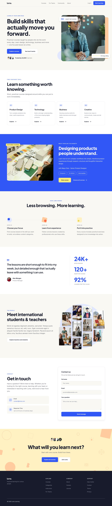
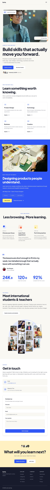
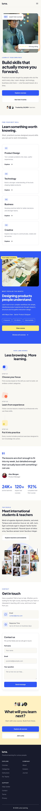

# Luma — Buzzvel front-end test

A responsive landing page for **Luma**, an online-learning brand, built from the provided Figma file
(`JuWeHeNrkFCbfEwoz3hpDf`, desktop frame `2:7` at 1280px and mobile frame `2:4195` at 402px).

**Stack:** Next.js 16 (App Router) · React 19 · TypeScript · Tailwind CSS 4 · Vitest + Testing Library

| Desktop (1280px) | Tablet (768px) | Mobile (402px) |
| --- | --- | --- |
|  |  |  |

---

## Getting started

Requirements: **Node.js ≥ 20.9** (CI uses Node 22) and npm.

```bash
npm install          # install dependencies
npm run dev          # start the dev server on http://localhost:3000
```

### Production build

```bash
npm run build        # create an optimized production build
npm run start        # serve it on http://localhost:3000
```

### Quality checks

```bash
npm run lint         # ESLint (next/core-web-vitals + TypeScript rules)
npm run typecheck    # tsc --noEmit
npm test             # Vitest, single run (npm run test:watch for watch mode)
```

The same four steps run on every push / pull request through GitHub Actions (`.github/workflows/ci.yml`).

---

## Project structure

```
src/
├─ app/
│  ├─ layout.tsx        # fonts (next/font), metadata, viewport
│  ├─ page.tsx          # composes the sections
│  ├─ globals.css       # Tailwind import + design tokens (@theme) + base styles
│  └─ icon.svg          # favicon
├─ components/
│  ├─ sections/         # one component per Figma section
│  │  ├─ Header.tsx  (client – mobile menu)
│  │  ├─ Hero.tsx · Categories.tsx · FeaturedCourse.tsx · HowItWorks.tsx
│  │  ├─ Testimonial.tsx · MeetPeople.tsx · Contact.tsx · FinalCta.tsx · Footer.tsx
│  │  └─ ContactForm.tsx (client – validation + success state)
│  └─ ui/               # small, typed building blocks
│     ├─ Button.tsx (Button + ButtonLink) · Container.tsx · Eyebrow.tsx · SectionHeading.tsx
│     └─ CategoryCard.tsx · StepItem.tsx · StatItem.tsx · Pill.tsx · AvatarStack.tsx · FormField.tsx
├─ data/content.ts      # typed mock content (all copy lives here)
├─ types/content.ts     # content types
├─ lib/                 # cn() helper, contact-form validation
└─ fonts/               # self-hosted variable fonts (SIL OFL)
public/images/          # every image/icon exported from Figma
```

---

## Decisions

**Component model.** Each Figma section maps to one component in `components/sections`, and the
repeated pieces (buttons, eyebrow labels, headings, cards, steps, stats, pills, avatar stacks, form
fields) are small typed components in `components/ui`. Sections receive their slice of
`data/content.ts` as props, so no copy is hard-coded in JSX and the page could be fed by a CMS later
without touching markup.

**Server first.** Everything is a Server Component except the two pieces that need state: `Header`
(mobile menu) and `ContactForm`. The page is fully static (`○ /` in the build output).

**Design tokens.** Colours, the Desktop/Mobile text styles (size, line-height, letter-spacing) and
shadows from the Figma variables live in the Tailwind theme (`@theme` in `globals.css`), so the
components use classes like `bg-brand`, `text-ink-muted`, `text-h3-m md:text-h3`. The mapping from
Figma variable names to token names is documented at the top of `globals.css` (it also fixes the
`backgrounnd-*` typo in the Figma variable names).

**Fonts.** Plus Jakarta Sans (headings) and Inter (body) are loaded with `next/font/local` from
variable `.woff2` files in `src/fonts`. `next/font/google` is the more common choice, but it
downloads fonts at build time; self-hosting the files makes the build reproducible offline and in
locked-down CI. You still get everything `next/font` provides: preloading, `font-display: swap`,
size-adjusted fallbacks and no layout shift.

**Images.** All 34 image/icon references were exported from Figma into `public/images` (31 files:
three avatars in the final CTA were byte-identical to the hero ones and are shared). Everything
renders through `next/image` with explicit sizes or `fill` + `sizes`. Only the hero photo is
preloaded (`preload`, which replaces the deprecated `priority` prop in Next 16). Decorative images
have empty `alt` text and the content images have descriptive alt text. The three "How it works"
illustrations and the hero/CTA blobs are plain rectangles and circles in Figma, so they are drawn
with CSS rather than exported as images.

**Responsive strategy.** The design has two frames, so the breakpoints follow them:

| Range | Layout |
| --- | --- |
| < 768px | Mobile frame (402px) |
| 768–1023px | Tablet: mobile structure, desktop type scale, multi-column grids where they fit (2-column categories, 3-column steps/stats, 4-column footer) |
| ≥ 1024px | Desktop frame. Gutters are 40px up to 1279px and 80px from 1280px; content is capped at 1120px |

Between 1024 and 1279px a few things are scaled down so they fit: the hero image is 400px instead
of 500px and the people collage is shown at 85% zoom. Every photo in the collage keeps its exact
Figma size per frame, set through CSS custom properties from the data file.

**Mobile menu.** The menu button (`aria-expanded` / `aria-controls`) opens a full-height
`role="dialog"` with `aria-modal`. While it is open:
- focus moves into the menu and Tab / Shift+Tab are kept between the close button and the menu
  items;
- **Esc** closes it and returns focus to the button;
- page scroll is locked, and `<main>` and the footer are made `inert`.

It also closes when a link is followed or when the viewport grows to desktop size. Below 1024px the
desktop header doesn't fit (at 768px "Log in" wrapped onto two lines), so the hamburger menu is used
up to 1023px.

**Contact form.** Validation runs on the client (`lib/validateContact.ts`):
- the name is required (at least 2 characters), the email must be well-formed, and the message
  needs at least 10 characters;
- errors appear when a field loses focus and on submit, never while the user is typing into a field
  they haven't left yet;
- errors are linked to their field with `aria-invalid` / `aria-describedby`, and on submit focus
  goes to the first invalid field.

A valid submission shows a "Sending…" state, then a success panel (`role="status"`) that receives
focus and has a "Send another message" reset. There is no backend, so submission is simulated with
a short delay.

**Motion.** The animations are kept light:
- the hero content fades and rises in with a small stagger;
- sections reveal on scroll using CSS scroll-driven animations (`animation-timeline: view()`), with
  no JavaScript and no hidden-until-JS content;
- cards and arrow links have hover effects.

All motion is wrapped in `prefers-reduced-motion: no-preference`, and a global reduced-motion rule
also disables smooth scrolling. In browsers without scroll-driven animations the content is simply
shown without the reveal.

**Accessibility & SEO.**
- The page has a skip link, landmark elements (`header`, `nav`, `main`, `footer`) and one `h1`,
  with `h2` for sections and `h3` for cards.
- The testimonial is marked up as `figure` / `blockquote` / `figcaption`, and the stats as a `dl`.
- The rating badge has an accessible name ("5 out of 5 stars"), focus states are visible, and the
  form labels are real `<label>` elements.
- Metadata includes a title, description, Open Graph and Twitter cards, plus a viewport theme
  colour.

---

## Design notes (deviations from the Figma file)

Intentional corrections:

1. **Step numbers.** On desktop all three "How it works" steps say **STEP 01**. They are numbered
   **01 / 02 / 03**, as in the mobile frame.
2. **Contact form language.** The mobile contact form is in Portuguese ("Nome completo", "Enviar
   mensagem", …). The English copy from the desktop frame is used at every size.
3. **Lorem ipsum kept.** The "Meet international students & teachers" paragraph is Lorem Ipsum in
   Figma and is kept as-is, because it is placeholder content from the design.

Smaller inconsistencies between the two frames, and how they were resolved:

- **Step 2 copy.** It reads "…professionals who use these skills" on desktop and "…who *actually*
  use these skills" on mobile. The desktop copy is used everywhere.
- **Per-frame styles kept.** Where the frames differ only in style, each breakpoint follows its own
  frame:
  - the step 2 icon is a translucent coral square on mobile and a peach square on desktop;
  - the "Meet" paragraph is `text-primary` on mobile and `text-secondary` on desktop;
  - the Featured Course pills and the footer copyright change colour and alignment between frames.
- **Container width.** The FeaturedCourse, Testimonial and Footer containers are 1136px wide in
  Figma, but 1280 − 2 × 80 = 1120px. Everything uses the 1120px content width, and the footer's
  416/208/208/208 columns became a 2fr/1fr/1fr/1fr grid.
- **Close icon.** The open-menu (✕) icon isn't in the design. It is drawn to match the hamburger
  icon's 1.5px stroke.

## Known gaps

- **No backend.** The form doesn't send anything (submission is simulated). Links that point to
  pages that don't exist yet ("Log in", "View course", "Careers", "Terms", …) use `#`. Navigation
  links scroll to the matching sections.
- **No tablet frame.** The 768–1023px layout is my own interpolation between the two frames.
- **Firefox.** The scroll reveal needs scroll-driven animations (Chrome/Edge 115+, Safari 26+).
  Firefox shows the content without the reveal effect.
- **Form not wired up.** Hooking the form to an API route or a server action would be the natural
  next step.
- **Unit tests only.** The tests cover the contact form, its validation and the mobile menu. There
  are no end-to-end or visual-regression tests in CI. The visual check was done manually against
  the Figma frames at 360, 402, 768, 1024, 1280 and 1440px.
- **Static export.** `next/image` optimisation needs the Next.js server, for example on Vercel. A
  static export would need `images.unoptimized`.

## Time spent

About **25 minutes** of hands-on time, end to end:

- reading the Figma file and exporting assets: ~6 min;
- setup and tokens: ~3 min;
- sections and components: ~9 min;
- tests, visual QA at five widths, and README: ~7 min.

This was done with an AI agent (see below), so the figure reflects agent-assisted work, not
hand-coding time.

## AI tools used

- **Claude (Anthropic), working as a coding agent.** It read the design through the **Figma MCP
  server** (`get_design_context` for each section, which also exported the assets), scaffolded the
  project, and wrote the components, tests and this README. It also ran headless Chrome (Playwright)
  screenshots at several widths to compare against the Figma renders.
- **How the output was handled.** The Figma-generated reference code was used only as a spec:
  absolute positions were converted into flex/grid layouts, colours and type became theme tokens,
  and the interactive parts (menu, form) were written from scratch with accessibility in mind.
- **Review.** All code was reviewed, linted, type-checked, unit-tested and built before committing.

Font files: Inter and Plus Jakarta Sans, © their authors, licensed under the SIL Open Font License
(see `src/fonts/OFL-*.txt`).
