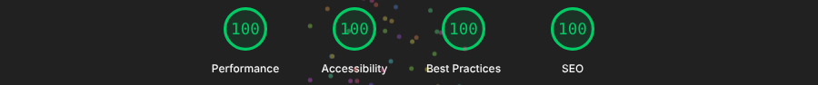

# Frontend Engineer Coding Challenge

**Luís Eduardo de Souza**

_Luma — building a landing page from Figma_

Luma is a fictional online-learning brand, and this repository is its landing page, built for the
Buzzvel front-end test. The brief was a Figma file with two frames: desktop at 1280px
(`2:7`) and mobile at 402px (`2:4195`). This README walks through how
that file became a working page, what I decided along the way and what is still open.

| Desktop (1280px) | Tablet (768px) | Mobile (402px) |
| --- | --- | --- |
|  |  |  |

**Stack:** Next.js 16 (App Router) · React 19 · TypeScript · Tailwind CSS 4 · Vitest + Testing Library

## Try it

You need Node.js 20.9 or newer (CI uses Node 22).

```bash
npm install
npm run dev                         # http://localhost:3000
npm run build && npm run start      # production build
npm run lint && npm run typecheck && npm test
```

GitHub Actions runs lint, typecheck, tests and the build on every push and pull request.

---

## From frames to components

I started by reading the Figma file section by section and treating each section as one component:
`Header`, `Hero`, `Categories`, `FeaturedCourse`, `HowItWorks`, `Testimonial`, `MeetPeople`,
`Contact`, `FinalCta` and `Footer`, all in `src/components/sections`. The pieces that repeat across
sections (buttons, eyebrow labels, headings, cards, steps, stats, pills, avatar stacks, form fields)
became small typed components in `src/components/ui`.

None of the copy is written into the JSX. All of it lives in `src/data/content.ts`, typed by
`src/types/content.ts`, and each section receives its own slice as props. If the page later moves to a
CMS, the markup doesn't have to change.

The Figma variables became the design system. Colours, the desktop and mobile text styles and the
shadows are Tailwind theme tokens (`@theme` in `globals.css`), so components read like
`bg-brand text-ink-muted text-h3-m md:text-h3`. The mapping from Figma names to token names sits at
the top of `globals.css`. It also fixes the `backgrounnd-*` typo in the Figma variable names.

Almost everything is a Server Component. Only two parts need client state: the mobile menu in
`Header` and the `ContactForm`. The result is a fully static route.

## The page between the two frames

The design shows 402px and 1280px and nothing in between, so I had to decide what happens in the
gap:

- **Below 768px** the page follows the mobile frame.
- **From 768px to 1023px** it keeps the mobile structure but uses the desktop type scale and switches
  to multi-column grids wherever they fit.
- **From 1024px** it follows the desktop frame, with 40px gutters up to 1279px, 80px from 1280px and
  content capped at 1120px.

The narrow end of desktop was the tight spot. Between 1024px and 1279px the hero image shrinks from
500px to 400px and the people collage is shown at 85% zoom, while every photo keeps its exact Figma
size per frame. The full desktop header didn't fit below 1024px either ("Log in" wrapped onto two
lines at 768px), so the hamburger menu stays until 1023px.

## Things the design didn't say

Some decisions came from places the Figma file left open or contradicted itself:

- **Step numbers.** All three desktop steps say "STEP 01". I numbered them 01, 02 and 03, as the mobile
  frame does.
- **A form in two languages.** The mobile contact form is in Portuguese ("Nome completo", "Enviar
  mensagem"). The page uses the English desktop copy at every size.
- **Contrast.** Two Figma colours measured 4.45:1, just under WCAG AA's 4.5:1. I darkened
  `text-tertiary` from `#6d7384` to `#6b7182` and lightened `text-white-secondary` from `#e7e7ec` to
  `#ebebf0`. You can't see the difference, but both now pass.
- **Featured Course pill borders.** In Figma the "8 lessons / 2h 40min / Intermediate" pills are
  stroked with `line-1` (#dbdfeb), the grey used for dividers on light backgrounds. On the brand
  blue, the antialiased rounded corners turn a greyish lilac that doesn't match the straight edges.
  Copying it exactly would bring that defect along, so the pills use a translucent white border
  (`white/80`) instead. It has the same weight, and the corners stay the same colour as the edges.
- **Testimonial name style.** Alex Morgan's name uses a different text style in each frame (mobile
  subtitle 1, 16/26; desktop subtitle 2, 16/28), and both are Regular with a local Bold override.
  The code keeps the per-frame line heights with the matching tokens plus `font-bold`. A cleaner
  design file would have one bold "author name" style.
- **Container width.** A few containers are 1136px wide in Figma, but 1280 − 2 × 80 = 1120px, so
  everything uses 1120px.
- **A missing icon.** The design has no close (✕) icon for the open menu. I drew one with the same
  1.5px stroke as the hamburger.
- **Per-frame styles.** Where the two frames differ only in style, such as the step 2 icon colour, the
  "Meet" paragraph colour and the pill and copyright alignment, each breakpoint follows its own
  frame. The step 2 copy differs too, and the desktop wording is used everywhere.
- **Lorem ipsum.** The "Meet international students & teachers" paragraph is placeholder text in
  Figma, and it stays that way here.

## Making it usable for everyone

Accessibility was part of the build from the start, not something checked at the end.

The page has a skip link, proper landmarks, one `h1`, and section and card headings in order. The
testimonial is a `figure` with a `blockquote`, and the stats are a `dl`.

The **mobile menu** is a real modal dialog. Focus moves into it and stays there while Tab cycles
through it. Esc closes it and returns focus to the button. While it is open, the page behind stops
scrolling and becomes `inert`. It also closes when you follow a link or widen the window.

The **contact form** shows an error when you leave a field or submit, never while you are still
typing. Each error is linked to its field, and on submit focus jumps to the first problem.

### What happens when you press "Send message"

There is no backend, so the send is simulated. Step by step (`handleSubmit` in `ContactForm.tsx`):

1. The browser's default submit is stopped, and a second click while sending does nothing.
2. All three fields are checked at once. If any is invalid, every error appears, focus moves to the
   first bad field (name, then email, then message) and the form stops there.
3. The button is disabled and reads "Sending…".
4. Instead of a network request, the form waits 800ms. The trimmed values are then handed to an
   optional `onSubmitted` callback. The tests use it, but the page doesn't pass one, so **the
   message is discarded**.
5. The form is replaced by a success panel ("Thanks — your message is on its way."). It has
   `role="status"`, so screen readers announce it, and focus moves to its heading.
6. "Send another message" clears everything, brings the form back and puts focus on the name field.

There is no error state, because a simulated send can't fail.

**Motion** stays light. The hero fades in with a small stagger, sections rise into place through CSS
scroll-driven animations (no JavaScript, and content is never hidden waiting for it), and cards react
on hover. All of it is switched off for people who prefer reduced motion.

## Making it findable

The page ships with a title, description, canonical URL, Open Graph and Twitter cards, a generated
`robots.txt` and `sitemap.xml`, and `Organization`/`WebSite` JSON-LD. The social preview is a
1200×630 image rendered at build time from `app/opengraph-image.tsx`, in the brand colours.

The site's address comes from the `NEXT_PUBLIC_SITE_URL` environment variable (`src/lib/site.ts`).
Until it is set, those URLs point to the placeholder `luma.example.com`.

## Performance

Fonts are self-hosted variable files loaded through `next/font/local`, so the build doesn't depend on
reaching Google Fonts. You still get preloading, `font-display: swap` and no layout shift.

Every image from Figma was exported into `public/images` and is served through `next/image`. Only the
hero photo is preloaded. The blobs and the "How it works" illustrations are just rectangles and
circles in the design, so they are drawn with CSS instead of shipped as images.

Lighthouse on the local production build:

| Mobile | Desktop |
| --- | --- |
|  |  |

The only score below 100 is mobile performance, held back by the hero photo's LCP (about 3 s on
simulated slow 4G). Layout shift is zero on both.

## What's still open

- The form doesn't send anything yet: the visitor sees the success message, but the message is
  never sent or stored. Making it real would take a Server Action or `route.ts` handler that
  validates again on the server (reusing `validateContact`) and sends an email or saves the
  message, an error state that keeps what was typed and offers a retry, and basic spam protection
  (a honeypot field and rate limiting).
- Links to pages that don't exist yet point to `#`.
- The tablet layout is my own interpolation, because the design has no tablet frame.
- Firefox shows the content without the scroll reveal, because it doesn't support scroll-driven
  animations yet.
- The tests are unit tests only. They cover the form, its validation and the mobile menu. The visual
  check against Figma was done by hand at 360, 402, 768, 1024, 1280 and 1440px.
- `next/image` optimisation needs a Next.js server. A static export would need `images.unoptimized`.

Inter and Plus Jakarta Sans are © their authors, licensed under the SIL Open Font License (see
`src/fonts/OFL-*.txt`).
